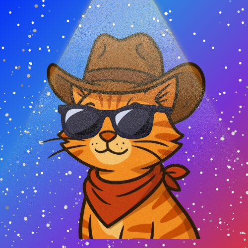
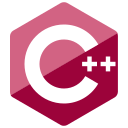

  

<h1 align="center"> Gustavo D. Costa </h1>

  <em>GEII Student | Embedded Systems & Low-Level Software Development</em> 
  <strong>Bridging electrical engineering hardware with firmware</strong>

---

### Projects I'm Working On

- **Hardware & Software Integration:** Combining CAD design with electrical engineering fundamentals to build custom embedded systems and firmware.

---

### Currently Learning

- **Degree:** Currently pursuing a **Licence GEII** (Electrical Engineering & Industrial Computing).
- **Focus:** Combining CAD, circuit design, and microcontroller programming (C/C++) into real-world embedded projects.

---

### What I Bring to the Table

- **Analytical & Critical Thinking:** Grounded in rigorous engineering logic and hardware/software troubleshooting.
- **Problem Solving:** Focused on resource-constrained programming, low-level optimization, and debugging.
- **Teamwork & Collaboration:** Communicative, adaptable, and eager to build reliable systems with cross-functional teams.

---

### Tech Stack

  
  
  
  
  
  
  

---

### GitHub Stats

  

  

---

### Fun Facts & Goals

- Funny, approachable, and highly collaborative.
- Driven by solving tangible engineering problems.
- **Goal:** Secure an embedded systems or firmware engineering role to jumpstart my career.

---

### Quote That Fuels Me

> *"Those who can make you believe absurdities can make you commit atrocities."*  
> — **Voltaire**

---

### Connect with Me

  
  

